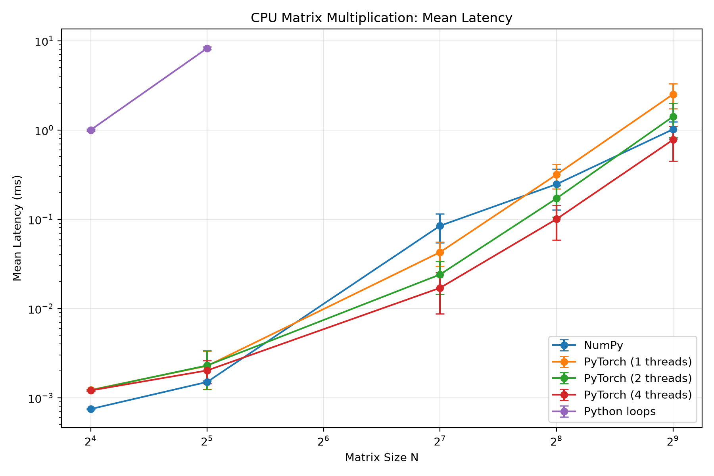
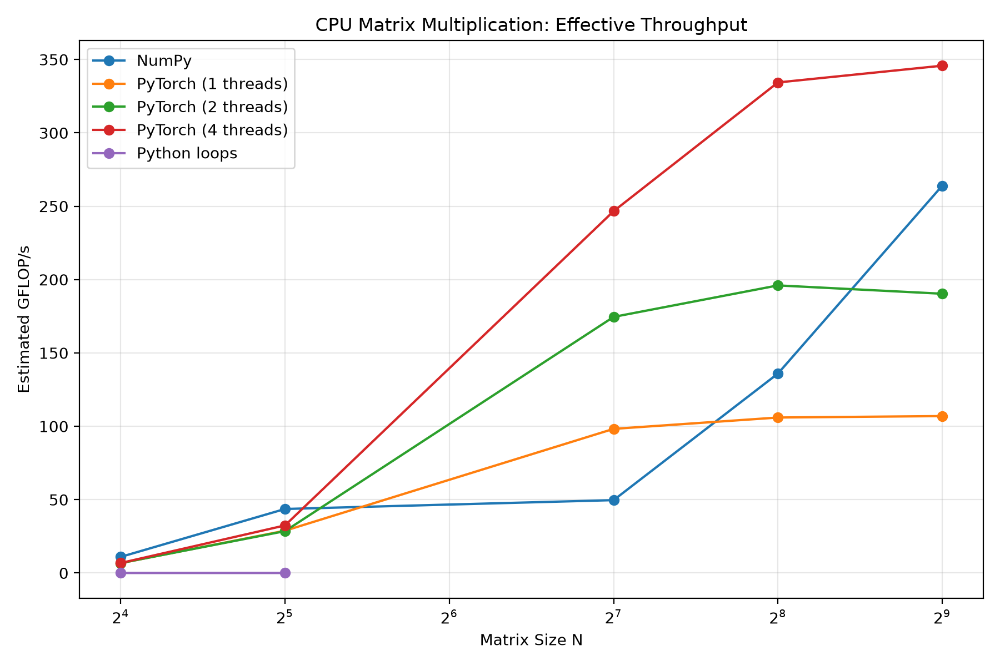

# A Preliminary Benchmark of CPU Matrix Multiplication

**Project:** Matrix Performance Lab
**Author:** Shen Yuxuan
**Affiliation:** Yuanpei College, Peking University
**Date:** 2026.10.18

## 1. Introduction

Matrix multiplication is a fundamental operation in machine learning and scientific computing. Although the mathematical operation is straightforward, its actual execution time can vary considerably depending on the implementation, matrix dimensions, and hardware configuration.

In this project, I compare the CPU performance of three matrix multiplication implementations: naive Python loops, NumPy, and PyTorch. I also investigate how different PyTorch thread settings affect execution time across matrix sizes.

The experiment is intended as an introduction to performance benchmarking and empirical analysis of numerical computing systems. Rather than attempting to establish which library is universally faster, I focus on understanding the observed performance differences, the effects of parallel execution, and the reliability of the measurements.

## 2. Experimental Methodology

### 2.1 Workloads and Implementations

The experiment evaluates dense square matrix multiplication:

$$
C=A B,\qquad A,B\in\mathbb{R}^{N\times N}
$$

with matrix sizes:

$$
N\in\{16,32,128,256,512\}.
$$

Three implementations are tested:

* **Python loops:** A direct matrix multiplication implementation using three nested loops. Because of its relatively high execution time, it is evaluated only at \(N=16\) and \(N=32\).
* **NumPy:** Matrix multiplication using the `@` operator.
* **PyTorch:** CPU tensor multiplication using the `@` operator, evaluated with thread settings of 1, 2, and 4.

Input matrices are generated from a standard normal distribution using fixed pseudorandom seeds and stored as NumPy `float32` arrays. PyTorch tensors are constructed from copies of these arrays.

The naive Python implementation performs scalar operations using Python floating-point values and accumulates results in a `float64` array. Therefore, its numerical execution path is not identical to that of the optimized `float32` implementations.

### 2.2 Timing and Metrics

Before benchmarking, the implementations are checked against NumPy results using numerical tolerances.

Execution latency is measured using `torch.utils.benchmark.Timer` with:

```python
blocked_autorange(min_run_time=0.2)
```

For each benchmark session, the reported latency is the median estimated execution time per matrix multiplication. Input generation, tensor conversion, and correctness checking are excluded from the timed region.

Effective computational throughput is estimated as:

$$
\text{GFLOP/s}=\frac{2N^3}{t\times10^9},
$$

where \(t\) is the measured latency in seconds.

The formula uses an approximate floating-point operation count for dense matrix multiplication. It is an estimated effective throughput rather than a direct measurement of executed hardware instructions.

The complete benchmark was executed independently three times under the same recorded hardware and software configuration. Each run produced 22 measurements, covering the selected implementations, matrix sizes, and thread settings.

For each configuration, I calculated the mean latency, sample standard deviation, and coefficient of variation (CV) across the three independent runs:

$$
CV=\frac{s}{\bar t}\times100\%,
$$

where \(s\) is the sample standard deviation and \(\bar t\) is the mean latency.

These statistics describe run-to-run variability and should be distinguished from the repeated measurements performed internally by `torch.utils.benchmark.Timer` during each session.

For aggregate throughput comparisons, I calculate estimated throughput from the mean latency. This is not mathematically equivalent to taking the arithmetic mean of the three individual throughput measurements.

### 2.3 Execution Environment

The experiments were conducted on a Windows 11 laptop with an Intel Core Ultra 9 285H processor.

| Component                         | Configuration                         |
| --------------------------------- | ------------------------------------- |
| CPU                               | Intel Core Ultra 9 285H               |
| CPU cores                         | 16 cores, 16 logical processors       |
| Operating system                  | Windows 11 Home, build 26200          |
| Python                            | 3.11.17                               |
| NumPy                             | 2.4.6                                 |
| PyTorch                           | 2.14.1+cpu                            |
| NumPy BLAS backend                | OpenBLAS 0.3.31.188.0                 |
| OpenBLAS thread count             | 16, reported by a separate inspection |
| PyTorch benchmark thread settings | 1, 2, and 4                           |
| Input data type                   | float32                               |
| Computing device                  | CPU                                   |

NumPy uses OpenBLAS as its underlying BLAS implementation. A separate inspection using `threadpoolctl` reported 16 threads. However, the BLAS thread count was not explicitly fixed during the benchmark sessions, and the thread configuration of each individual NumPy measurement was not independently recorded.

Therefore, the NumPy results should not be interpreted as a controlled single-thread comparison with PyTorch.

### 2.4 Reproducibility

The benchmark was implemented in Python using NumPy, PyTorch, and `torch.utils.benchmark`.

The experiment can be reproduced by running the following commands from the project root directory:

```bash
python -m pytest test_matmul.py -v
python benchmark.py
```

Each execution of `benchmark.py` produces `results/benchmark.csv`. The three independent runs were saved separately as `benchmark_run1.csv`, `benchmark_run2.csv`, and `benchmark_run3.csv`.

The aggregate statistics can be regenerated using:

```bash
python analyze_runs.py
python plot_summary.py
```

The raw benchmark results, aggregation script, and plotting script are included in the project repository.


## 3. Results


The following figures summarize the results of three
independent benchmark runs.



*Figure 1. Mean CPU matrix multiplication latency across three
independent runs. Error bars indicate ±1 sample standard deviation.
Both axes use logarithmic scales.*



*Figure 2. Estimated effective throughput calculated from the
mean latency of three independent runs. The x-axis uses a
logarithmic scale.*

### 3.1 Comparison of Implementations

The naive Python implementation is substantially slower than NumPy and PyTorch on the smallest workloads.

Across the three runs, Python loops required an average of approximately 1.000 ms at \(N=16\) and 8.241 ms at \(N=32\). The corresponding NumPy mean latencies were approximately 0.000747 ms and 0.001502 ms.

These results are consistent with the high overhead of performing scalar arithmetic through interpreted Python loops compared with optimized numerical libraries.

However, the implementations also differ in numerical precision and execution strategy. Consequently, the observed performance gap cannot be attributed exclusively to Python interpreter overhead.

The naive implementation was excluded from larger matrix sizes because of its relatively high execution time.

### 3.2 Effect of PyTorch Thread Count

The measurements suggest that the benefit of PyTorch multithreading depends on workload size.

For small matrices, the differences between thread configurations were relatively limited. At \(N=16\), all three PyTorch configurations had mean latencies close to 0.0012 ms.

For larger matrices, increasing the number of threads produced substantial reductions in mean latency.

| Matrix size | 1 thread (ms) | 2 threads (ms) | 4 threads (ms) | 4-thread speedup over 1 thread |
| ----------- | ------------: | -------------: | -------------: | -----------------------------: |
| 128         |      0.042698 |       0.024030 |       0.017008 |                          2.51× |
| 256         |      0.316655 |       0.171190 |       0.100360 |                          3.16× |
| 512         |      2.510085 |       1.410338 |       0.776363 |                          3.23× |

The speedups are calculated from the mean latencies of the three independent runs.

The results indicate that additional threads can provide substantial benefits for larger matrix multiplication workloads. However, the observed speedups should not be interpreted as ideal parallel scaling or as performance guarantees under different execution conditions.

### 3.3 Run-to-Run Variability

One of the most notable findings is the considerable variation between independent benchmark runs.

For NumPy, the coefficient of variation reached 35.51% at \(N=128\), 48.50% at \(N=256\), and 21.89% at \(N=512\).

For four-thread PyTorch, the corresponding CV values were 48.46%, 41.60%, and 42.03%.

By contrast, the naive Python implementation showed relatively low variability, with CV values of 2.65% at \(N=16\) and 3.30% at \(N=32\).

The following table summarizes selected configurations:

| Implementation     | Matrix size | Mean latency (ms) |     CV |
| ------------------ | ----------: | ----------------: | -----: |
| NumPy              |         128 |          0.084457 | 35.51% |
| NumPy              |         256 |          0.246865 | 48.50% |
| NumPy              |         512 |          1.016877 | 21.89% |
| PyTorch, 4 threads |         128 |          0.017008 | 48.46% |
| PyTorch, 4 threads |         256 |          0.100360 | 41.60% |
| PyTorch, 4 threads |         512 |          0.776363 | 42.03% |
| Python loops       |          16 |          1.000195 |  2.65% |
| Python loops       |          32 |          8.240950 |  3.30% |

The causes of this variability remain unclear. Potential contributing factors include background system activity, CPU frequency changes, thread scheduling, and differences in the execution behavior of numerical libraries.

The current experiment does not isolate these factors.

Given the observed variability, small differences between configurations should not be treated as evidence of stable performance rankings.

### 3.4 Effective Computational Throughput

Estimated throughput generally increases with workload size for the optimized implementations, although its magnitude varies substantially between independent runs.

For four-thread PyTorch, the estimated effective throughput derived from the measured latency was approximately 225.87, 445.20, and 434.92 GFLOP/s at \(N=256\) across the three independent runs.

At \(N=512\), the corresponding estimates were approximately 232.80, 451.10, and 462.06 GFLOP/s.

Thus, all three independent runs showed slightly higher throughput at \(N=512\) than at \(N=256\) for the four-thread PyTorch configuration.

Using the mean latency across the three runs, the estimated effective throughput was approximately 334.3 GFLOP/s at \(N=256\) and 345.7 GFLOP/s at \(N=512\).

An earlier preliminary measurement had shown a decrease in throughput between these matrix sizes. However, that decrease was not reproduced in the three independent runs reported here.

This discrepancy illustrates the importance of repeated measurements before interpreting an isolated performance trend as a stable characteristic of the underlying implementation.

## 4. Discussion

Three observations emerge from the experiment.

First, implementation choice has a substantial effect on performance. Even for small matrices, optimized numerical libraries achieve much lower execution latency than explicit Python loops. This motivates further investigation into the implementation of high-level tensor operations and the role of optimized computational kernels.

Second, multithreading becomes more beneficial as matrix size increases. In the three-run averages, PyTorch with four threads achieves approximately 3.16× and 3.23× speedups over the one-thread configuration at \(N=256\) and \(N=512\), respectively.

Third, measurement stability is an important concern. Several optimized-library configurations exhibit substantial variation across independent runs, making it difficult to interpret small performance differences reliably.

The initial observation of decreasing four-thread throughput from \(N=256\) to \(N=512\) was not reproduced in the subsequent three runs. Rather than attributing the initial behavior to a specific hardware bottleneck, the current evidence suggests that more controlled experiments are needed.

These results highlight a distinction between obtaining performance measurements and establishing reliable performance conclusions. A benchmark can produce precise-looking latency values even when repeated runs exhibit substantial variability.

## 5. Limitations and Future Work

The experiment has several methodological limitations.

**Uncontrolled NumPy threading.** NumPy uses OpenBLAS, and a separate environment inspection reported 16 threads. However, the BLAS thread count was not explicitly controlled during benchmarking. Therefore, the NumPy and PyTorch measurements do not constitute a matched-thread comparison.

**Run-to-run variability.** Although the benchmark was executed independently three times, several configurations exhibited CV values above 30%. Three runs provide an initial indication of variability but are insufficient to characterize the full distribution of performance.

**Different numerical execution paths.** The naive Python implementation uses Python scalar operations and `float64` accumulation, while NumPy and PyTorch operate on `float32` inputs. A more controlled comparison would align numerical behavior more closely.

**Limited workload coverage.** Only square matrices and a small number of thread configurations were evaluated. The experiment does not cover rectangular matrices, different memory layouts, alternative numerical precisions, or GPU execution.

**Unmeasured system conditions.** CPU frequency, processor utilization, background workload, and thermal behavior were not systematically recorded during the benchmark sessions. Their possible influence on measurement variability remains unverified.

Future work should focus on explicitly controlling the BLAS thread count, recording relevant system conditions, and increasing the number of independent benchmark runs.

Further experiments could investigate how performance changes under different matrix shapes, memory layouts, and thread configurations.

## 6. Conclusion

This project established a basic workflow for benchmarking CPU matrix multiplication, including correctness checking, execution-time measurement, throughput estimation, and visualization.

The results demonstrate substantial performance differences between naive Python loops and optimized numerical libraries, as well as workload-dependent benefits from PyTorch multithreading.

The three independent benchmark runs also revealed considerable measurement variability in several configurations. This finding emphasizes the importance of experimental control and repeated measurements when evaluating computational performance.

The main outcome of this project is therefore not a definitive ranking of numerical libraries, but a preliminary understanding of matrix multiplication performance and the methodological challenges involved in obtaining reliable benchmark results.
